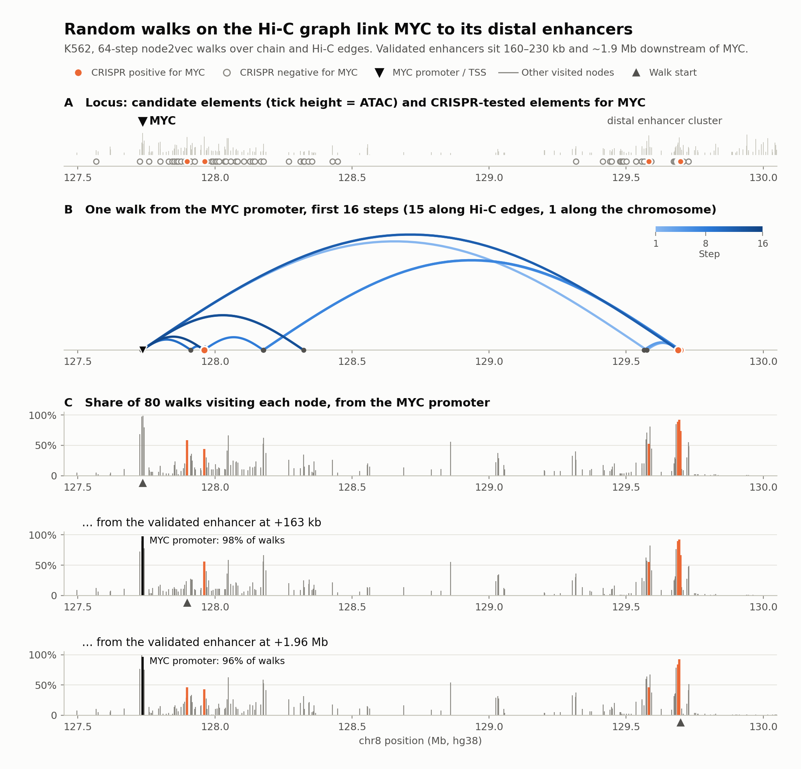

# Experiments

These are the final experiments: one comparison of six scores on the K562 CRISPR benchmark. Each row adds one ingredient to the row before it, so each step works as an ablation of the next. Earlier exploratory experiments (Mamba vs GNN, walk length, pairwise controls, the first ATAC ablation) are in the Git history of this file (commit `d942726` and before).

## Setup shared by every row

- **Benchmark.** `EPCrisprBenchmark_combined_data.training_K562`: 10,356 tested element–gene pairs with 471 positives (Gasperini2019, Nasser2021 and Schraivogel2020). "Covered" pairs are the 8,199 pairs (418 positives) whose element and gene TSS both map to graph nodes. Learned models score uncovered pairs last; distance and ABC score every pair. **Covered pairs are the fair scope for comparing rows**, and the headline numbers below use them.
- **Folds.** 5-fold chromosome-held-out cross-validation (`chromosome_folds` in `models.py`). Chromosomes are assigned greedily, largest first, to balance pair counts: fold 0 = chr19 alone; 1 = chr9, 11, 13, 16, 17; 2 = chr6, 7, X, 20, 21, 22; 3 = chr1, 2, 4, 12, 14, 15; 4 = chr3, 5, 8, 10, 18. Every pair is predicted exactly once by a model that never saw its chromosome. There is no validation set; every model trains for 30 epochs.
- **Inputs.**
  - Graph nodes: 111,311 candidate elements, i.e. ATAC summits ±250 bp plus TSS ±250 bp, merged, with blocklisted regions removed.
  - Node features: 129 per node, log ATAC (1) and a mean-pooled HyenaDNA-tiny sequence embedding (128).
  - Edges: chain edges between neighbouring elements, plus Hi-C edges where observed/expected ≥ 3 and the observed count ≥ 5 (ENCODE ENCFF621AIY, 5 kb resolution, SCALE-normalized).
  - Walks: per anchor node, 8 node2vec walks of 64 steps, resampled 10 times (p = 4, q = 1, chain weight β = 5; Hi-C steps weighted by O/E).
  - Everything is rebuilt from scratch by `download_data.py` and `prepare_data.py` (see the README).
- **Head.** Every learned row uses the same prediction head, `Linear → GELU → Dropout(0.1) → Linear`. Its input is:
  - whatever embeddings the row has: enhancer, gene and their elementwise product, 128 values each;
  - log distance;
  - when used, the 8 rE2G-like scalars.

  The scalars are standardized with each fold's training-pair mean and standard deviation; `--raw-scalars` turns this off.
- **rE2G-like scalars** (`--re2g-features`, `re2g_feature_matrix` in `models.py`):
  - log raw Hi-C contact between the element and TSS bins;
  - log ATAC at the element;
  - log ATAC at the promoter;
  - log ABC score;
  - log number of candidate elements strictly between element and TSS;
  - log number of promoter nodes in that interval;
  - log number of other candidate elements within ±10 kb of the element;
  - log summed ATAC of those elements.
- **Training.** Class-weighted binary cross-entropy, AdamW (lr 1e-3, weight decay 1e-2), batch 64, model width 128, 2 encoder layers. Test logits are averaged over 4 walk resamples.
- **Seeds.** 0, 1 and 2. Distance and ABC are deterministic.
- **Metric.** AUPRC (average precision) over pooled out-of-fold predictions, plus precision at 70% recall.
- **Environment.** Sherlock: torch 2.6.0+cu124, mamba-ssm and causal-conv1d built from source, mixed A100/H100/H200/L40S/RTX 3090 GPUs. The env is at `/home/groups/hanleeji/Virtual_envs/e2g`, with lockfiles inside.

## The runs and what each one ablates

| # | Row | What it adds over the row it is compared with | Ablation it answers |
| --- | --- | --- | --- |
| 1 | **Distance** | — | Baseline: rank by genomic distance only |
| 2 | **ABC** | ATAC activity × raw Hi-C contact, normalized over all elements around the gene (fixed formula) | Does a fixed formula for "context" beat distance? (2 vs 1) |
| 5a | **rE2G-like** | Learned head over distance + the 8 rE2G-like scalars, including the ABC score itself | Does a learned combination of hand-crafted context features beat the fixed formula? (5a vs 2) |
| 5b | **rE2G-like + HyenaDNA** | Each end's own node features (HyenaDNA embedding + ATAC) through the same input projection as the walk models, plus their product | What does the foundation-model representation of the two endpoints add? (5b vs 5a). Also the **matched no-walk control** for row 3 |
| 4 | **Full model without pair features** | Walk embeddings + distance only; no rE2G-like scalars in the head | What do the hand-crafted pair features add to the full model? (3 vs 4). Also: do walks alone beat ABC? (4 vs 2) |
| 3 | **Full model** | Attention over each anchor's walks, with the readout taken at the anchor token, plus distance and the rE2G-like scalars | Does learned neighbourhood context from random walks add anything? (3 vs 5b: identical except for the walks) |

Rows 3, 4, 5a and 5b share the head, the optimizer, the epochs, the folds and the standardization. Rows 3 and 5b differ **only** in whether each end is embedded from its walks (attention over 8 × 65 tokens) or from its own node features alone. Row 5b's HyenaDNA comparison is "not a perfect ablation": it also adds endpoint ATAC through the embedding, and the ATAC is already among the scalars.

### How to run

```bash
# one array task per seed (0-2); see sherlock/final.sbatch
python train.py --model attention --distance --re2g-features --batch 64 --seed $seed --run-dir runs/final/full-s$seed              # row 3
python train.py --model attention --distance                 --batch 64 --seed $seed --run-dir runs/final/full-no-pairfeat-s$seed  # row 4
python train.py --model endpoints --distance --re2g-features --batch 64 --seed $seed --run-dir runs/final/re2g-hyenadna-s$seed     # row 5b
python train.py --model pairwise  --distance --re2g-features --batch 64 --seed $seed --run-dir runs/final/re2g-s$seed              # row 5a
python evaluate.py runs/final/{full,full-no-pairfeat,re2g-hyenadna,re2g}-s$seed/predictions.parquet --output-dir runs/final/evaluation-s$seed
```

`evaluate.py` adds rows 1 (distance) and 2 (ABC) from `--data-dir` (default `data/processed`). In the output, the model columns are:

| Column | Row |
| --- | --- |
| `distance` | 1 |
| `abc` | 2 |
| `pairwise_distance_re2g` | 5a |
| `endpoints_distance_re2g` | 5b |
| `attention_distance` | 4 |
| `attention_distance_re2g` | 3 |

## Results

Pooled AUPRC, mean over seeds 0–2, with the range across seeds in brackets. Files: `results/final_s{0,1,2}.csv` and `results/final_folds_s{0,1,2}.csv`.

| # | Row | Covered | All pairs | Precision at 70% recall (covered) |
| --- | --- | ---: | ---: | ---: |
| 1 | Distance | 0.465 | 0.438 | 0.332 |
| 2 | ABC | 0.550 | 0.491 | 0.480 |
| 5a | rE2G-like | 0.627 [0.011] | 0.562 [0.010] | 0.560 |
| 5b | rE2G-like + HyenaDNA | **0.644** [0.050] | **0.577** [0.045] | 0.588 |
| 4 | Full model without pair features | 0.575 [0.036] | 0.515 [0.032] | 0.462 |
| 3 | Full model | 0.643 [0.029] | 0.576 [0.025] | **0.596** |

Covered AUPRC by seed:

| Seed | 5a | 5b | 4 | 3 |
| --- | ---: | ---: | ---: | ---: |
| 0 | 0.635 | 0.664 | 0.594 | 0.646 |
| 1 | 0.624 | 0.656 | 0.573 | 0.656 |
| 2 | 0.623 | 0.613 | 0.557 | 0.627 |

Covered AUPRC by dataset, mean of seeds:

| Row | Gasperini2019 | Nasser2021 | Schraivogel2020 (23 positives) |
| --- | ---: | ---: | ---: |
| Distance | 0.525 | 0.409 | 0.236 |
| ABC | 0.618 | 0.395 | **0.401** |
| 5a | 0.670 | 0.488 | 0.276 |
| 5b | **0.695** | 0.483 | 0.230 |
| 4 | 0.619 | **0.523** | 0.078 |
| 3 | 0.689 | 0.505 | 0.212 |

All-pairs AUPRC by fold, mean of seeds:

| Row | Fold 0 (chr19) | 1 | 2 | 3 | 4 |
| --- | ---: | ---: | ---: | ---: | ---: |
| Distance | **0.407** | 0.509 | 0.485 | 0.466 | 0.425 |
| ABC | 0.242 | 0.551 | 0.526 | 0.602 | 0.516 |
| 5a | 0.283 | 0.606 | 0.597 | 0.645 | 0.547 |
| 5b | 0.377 | 0.642 | 0.598 | **0.661** | 0.530 |
| 4 | 0.333 | 0.616 | 0.539 | 0.568 | 0.475 |
| 3 | 0.344 | 0.641 | 0.589 | 0.649 | **0.563** |

### What each ablation shows

- **ABC beats distance (2 vs 1): +0.085 covered.** It wins on Gasperini2019 and Schraivogel2020. It loses on Nasser2021 and badly on fold 0 (chr19, 0.242 vs 0.407).
- **rE2G-like beats ABC (5a vs 2): +0.073 to +0.084 at every seed.** This is the most robust gain in the table.
- **HyenaDNA/ATAC endpoints (5b vs 5a): +0.017 on average, not consistent.** Per seed: +0.029, +0.032, −0.010. Row 5b also has the largest seed range (0.050).
- **Walks (3 vs 5b): no measurable gain.** Per seed: −0.018, +0.000, +0.014. The walk model wins 7 of 15 fold-and-seed combinations, with a mean difference of −0.005. Its only small edge is precision at 70% recall (0.596 vs 0.588).
- **Pair features in the full model's head (3 vs 4): +0.052 to +0.082 at every seed.**
- **Walks alone vs ABC (4 vs 2):** walks plus distance beat ABC at every seed (0.557–0.594 vs 0.550), but stay well below the rE2G-like row.
- **Where everything is weak.**
  - Fold 0 (chr19, 43 positives, mostly Nasser2021): no learned row reaches distance.
  - Schraivogel2020: ABC is best, and the walk model without pair features collapses (0.078).

### By distance (covered pairs)

AUPRC within distance bins, mean of seeds. "Random" is each bin's positive rate.

| Bin | Pairs | Positives | Random | Distance | ABC | 5a | 5b | 3 |
| --- | ---: | ---: | ---: | ---: | ---: | ---: | ---: | ---: |
| < 10 kb | 156 | 103 | 0.660 | 0.799 | 0.813 | 0.846 | 0.849 | 0.849 |
| 10–50 kb | 641 | 173 | 0.270 | 0.336 | 0.480 | 0.604 | 0.619 | 0.608 |
| 50–200 kb | 1,825 | 98 | 0.054 | 0.135 | 0.439 | 0.626 | 0.652 | 0.668 |
| 200 kb–1 Mb | 5,241 | 38 | 0.007 | 0.012 | 0.090 | 0.089 | 0.131 | 0.165 |
| 100 kb–1 Mb | 6,387 | 69 | 0.011 | — | 0.125 | 0.230 | 0.258 | 0.298 |

- **Under 50 kb** (276 of the 418 covered positives) the walks add nothing. Pooled AUPRC is dominated by these pairs.
- **From 100 kb to 1 Mb** the full model leads: +15.6% over 5b and +29.6% over 5a, both relative.
- **From 200 kb to 1 Mb:** +26% over 5b and +84% over 5a. These gains rest on few positives.

### Leave-one-gene-out robustness (100 kb–1 Mb, covered pairs)

For each of the 1,699 genes in the bin, drop all of that gene's pairs and recompute AUPRC, per seed.

| Gap | All genes (mean; per seed) | Smallest after one removal | Removals that close it |
| --- | --- | --- | --- |
| 3 − 5a | +0.068 (+0.071, +0.088, +0.046) | +0.054 (NDUFV3) | none, at any seed |
| 3 − 5b (walks) | +0.040 (+0.041, +0.063, +0.018) | **+0.014 (MYC)** | none on the seed mean; at seed 2, MYC (−0.026) |

The gain over the rE2G-like row is not one locus. The walk-specific gain survives any single removal on the seed mean, but MYC alone accounts for about two-thirds of it. The same test on the narrower 200 kb–1 Mb bin is starker: without MYC, the walk gap goes negative on the seed mean (−0.009).

> **Figures are drafts.** The current figures are rough placeholders and will be reworked before publication.



`figures/myc_walks.py` draws the MYC locus. Walks from the MYC promoter reach its validated enhancers 160–230 kb and about 1.9 Mb downstream. 96–98% of walks from each enhancer visit the MYC promoter.

## Caveats

- **Single benchmark, one cell type.** The long-range comparisons rest on 38–69 positives, mostly from Gasperini2019.
- **No hyperparameter tuning.** All learned rows use one fixed configuration.
- **Not comparable with the A100 runs in the Git history.** Those used a different walk cache, embeddings and software versions. The distance and ABC numbers reproduce exactly (0.438/0.465 and 0.491/0.550), so the Hi-C and ATAC inputs match.
- **Pooled AUPRC mixes five fold models' scores in one ranking.** Per-fold numbers are in `results/final_folds_s*.csv`.
- **Published ENCODE-rE2G predictions are not included.** Held-out-chromosome predictions for this benchmark are on Synapse (syn53018671) but need an account to download.
